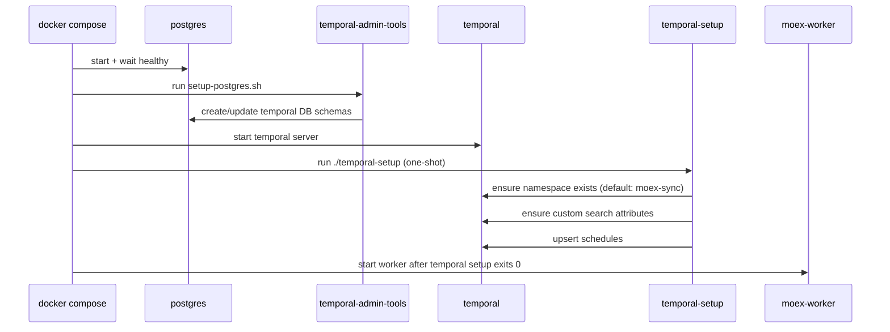
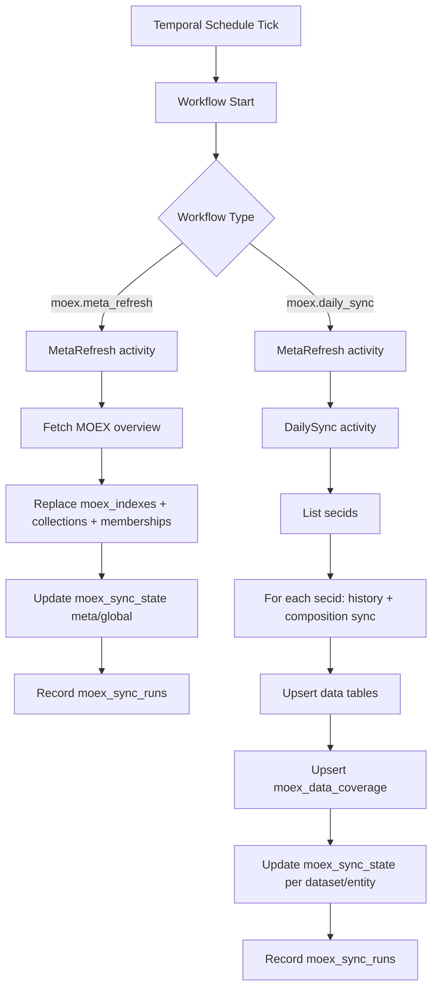

# Temporal MOEX Operations

This runbook explains what happens, when it happens, and where to check state for the Temporal-driven MOEX sync.

## Scope

- Services: `temporal`, `temporal-admin-tools`, `temporal-setup`, `moex-worker`
- Workflows: `moex.meta_refresh`, `moex.daily_sync`
- Storage: `moex_sync_state`, `moex_data_coverage`, `moex_sync_runs`, plus MOEX data tables

## Startup Orchestration

When you run `docker compose up` (or `task docker`), this is the startup order:



Important notes:

- `temporal-setup` is one-shot and should end with exit code `0`.
- `moex-worker` waits for temporal setup completion.
- If API migrations did not run yet, workflows can start but fail on missing tables.
- Custom Temporal search attributes are opt-in via `TEMPORAL_ENABLE_SEARCH_ATTRIBUTES=true` (default is off for compatibility).

## Schedule Timeline

Cron expressions are interpreted in `MOEX_SCHEDULE_TIMEZONE` (default `Europe/Moscow`).

| Schedule ID | Cron | Workflow | Purpose |
| --- | --- | --- | --- |
| `moex-meta-refresh-6h` | `0 */6 * * *` | `moex.meta_refresh` | Refresh index metadata (index list + memberships) |
| `moex-daily-sync` | `15 20 * * 1-5` | `moex.daily_sync` | Metadata refresh + sync all indexes history/composition |
| `moex-monthly-deep-resync` | `30 21 1 * *` | `moex.daily_sync` | Optional deep resync of mutable horizon only (`MOEX_ENABLE_MONTHLY_DEEP_RESYNC=true`) |

Expected behavior:

- Seeing schedules without immediate runs is normal.
- No explicit "run-now-on-create" step is configured.
- Schedules run in `MOEX_SCHEDULE_TIMEZONE` (default `Europe/Moscow`).

## Runtime Flow



Retry behavior:

- Both workflows retry activity failures up to 5 attempts.
- Backoff: starts at 2s, exponential up to 30s.
- In `moex.daily_sync`, each index sync runs as a separate activity. If one index still fails after all retries in a pass, that index is skipped for that pass and the workflow continues with the remaining indexes.
- For `mode=full` (manual backfill), if a pass finishes with failures, the workflow continues-as-new and runs another pass for failed indexes only.
- In `mode=full`, this loop continues until a pass completes with zero failed indexes.
- Failed index/dataset rows stay in error or incomplete coverage state (not marked complete), so a later run can retry them.

## Progress in Temporal UI

`moex.daily_sync` now executes index sync as one activity per index (`moex.sync_index_activity`), so execution history advances index-by-index in UI.

Full backfill (`mode=full`) runs indexes in parallel by default (4 workers) unless a custom `parallelism` is provided in workflow input.

If `TEMPORAL_ENABLE_SEARCH_ATTRIBUTES=true`, workflow search attributes are updated during the run:

- `MoexSecid`: current index being processed
- `MoexProgress`: `starting|running|completed`
- `MoexProcessed`: processed index count
- `MoexTotal`: total index count

This provides a simple progress bar model in UI (`MoexProcessed / MoexTotal`).

Activities also emit heartbeats with per-dataset/ticker details while running; these are visible in pending activity details.

Worker logs also include per-pass progress counters (`processed`, `completedIndexes`, `failedIndexes`, `progressPercent`) for `moex.daily_sync`.

## Logs: UI vs Worker

- Temporal UI shows workflow/activity event history, retries, failures, and search attributes.
- Worker `log.Printf(...)` output is not stored in Temporal history; view it from worker logs:

```bash
docker compose logs --tail=200 moex-worker
```

## Sync State and Coverage

`moex_sync_state` answers "latest known sync cursor/status" per `(dataset, entity_key)`:

- `status`: `running|ok|error`
- `checked_through_date`: latest date synced through
- `immutable_before_date`: historical boundary treated as immutable
- `mutable_since_date`: recent boundary rechecked regularly
- `last_success_at`, `last_attempt_at`, `retry_count`, `last_error`

`moex_data_coverage` answers "which date ranges were fetched" per `(dataset, entity_key)`:

- range `[from_date, to_date]`
- `is_complete=true|false` for that fetch window
- regular runs process incomplete ranges first, then run incremental windows from `checked_through_date - overlap` (history: 7 days, composition: 2 days)
- full-mode manual backfill runs in configurable date chunks across all indexes (default: 6 months) and continues-as-new chunk-by-chunk until reaching the goal range
- inside each index activity, full-mode fetch still uses year windows and skips already-complete coverage on rerun
- composition ticker progress is tracked in the same table via `dataset=composition_ticker` and `entity_key=<secid>|<ticker>`

`moex_sync_runs` is execution history:

- one row per run with `started_at`, `finished_at`, `status`, row counters, and error/details

## Backfill All History

- Full-history backfill is supported as a manual workflow start (not scheduled by default).
- Use `mode=full` with explicit `from` (for example `1997-01-01`).
- Optional: set `CHUNK_MONTHS` (default `6`) to control the full-mode chunk size used for continue-as-new passes.
- Monthly deep resync does not perform full-history backfill; it only rechecks mutable horizon.

## Why "No Runs Yet" Can Be Correct

You can see schedules in Temporal UI but no workflow runs yet if:

- next cron tick has not arrived (normal),
- or worker has not started yet,
- or worker started but failed quickly (for example, missing DB migrations).

## Monitoring Checklist

1. Temporal UI: schedules exist in namespace `moex-sync`.
2. Temporal UI: workflow executions appear after cron tick or manual trigger.
3. Worker logs: no startup crash and no repeated `relation does not exist`.
4. DB: `moex_sync_runs` receives new rows; `moex_sync_state` updates.
5. API coverage headers should be present on history/composition endpoints:
   `X-MOEX-Coverage-Status`, `X-MOEX-Coverage-Missing`, etc.

## Useful Commands (Repo Root)

Trigger schedules now:

```bash
docker compose run --rm --entrypoint temporal temporal-admin-tools schedule trigger --address temporal:7233 --namespace moex-sync --schedule-id moex-meta-refresh-6h
docker compose run --rm --entrypoint temporal temporal-admin-tools schedule trigger --address temporal:7233 --namespace moex-sync --schedule-id moex-daily-sync
```

List open workflows:

```bash
docker compose run --rm --entrypoint temporal temporal-admin-tools workflow list --address temporal:7233 --namespace moex-sync --query "ExecutionStatus='Running'"
```

Check worker and setup logs:

```bash
docker compose logs --tail=200 moex-worker
docker compose logs --tail=200 temporal-setup
```

Start full backfill manually:

```bash
task temporal:backfill
```

Optional bounded backfill (example):

```bash
task temporal:backfill FROM=2020-01-01 TILL=2020-12-31
```

Backfill with custom parallelism:

```bash
task temporal:backfill FROM=1997-01-01 PARALLELISM=6
```

Backfill with custom chunk size (example: 3 months per continue-as-new pass):

```bash
task temporal:backfill FROM=1997-01-01 CHUNK_MONTHS=3
```
