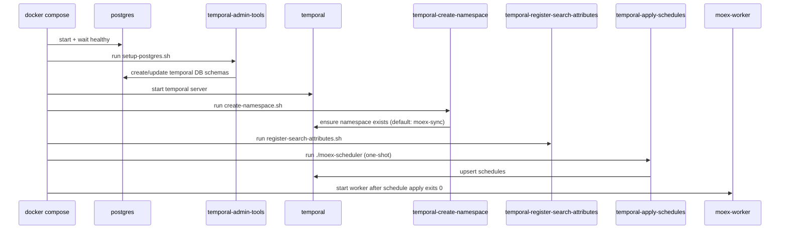
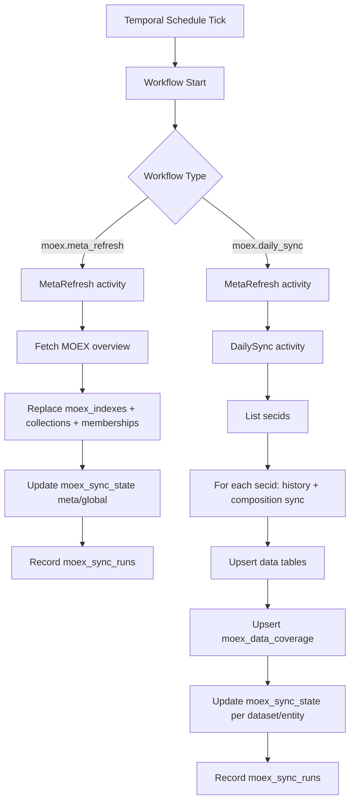

# Temporal MOEX Operations

This runbook explains what happens, when it happens, and where to check state for the Temporal-driven MOEX sync.

## Scope

- Services: `temporal`, `temporal-admin-tools`, `temporal-create-namespace`, `temporal-apply-schedules`, `moex-worker`
- Workflows: `moex.meta_refresh`, `moex.daily_sync`
- Storage: `moex_sync_state`, `moex_data_coverage`, `moex_sync_runs`, plus MOEX data tables

## Startup Orchestration

When you run `docker compose up` (or `task docker`), this is the startup order:



Important notes:

- `temporal-apply-schedules` is one-shot and should end with exit code `0`.
- `moex-worker` waits for schedule apply completion.
- If API migrations did not run yet, workflows can start but fail on missing tables.
- Custom Temporal search attributes are opt-in via `TEMPORAL_ENABLE_SEARCH_ATTRIBUTES=true` (default is off for compatibility).

## Schedule Timeline

Cron expressions are interpreted in `MOEX_SCHEDULE_TIMEZONE` (default `Europe/Moscow`).

| Schedule ID | Cron | Workflow | Purpose |
| --- | --- | --- | --- |
| `moex-meta-refresh-6h` | `0 */6 * * *` | `moex.meta_refresh` | Refresh index metadata (index list + memberships) |
| `moex-daily-sync` | `15 20 * * 1-5` | `moex.daily_sync` | Metadata refresh + sync all indexes history/composition |
| `moex-monthly-deep-resync` | `30 21 1 * *` | `moex.daily_sync` | Optional deep resync of mutable horizon (`MOEX_ENABLE_MONTHLY_DEEP_RESYNC=true`) |

Expected behavior:

- Seeing schedules without immediate runs is normal.
- No explicit "run-now-on-create" step is configured.
- Schedules run in `MOEX_SCHEDULE_TIMEZONE` (default `Europe/Moscow`).

## Runtime Flow



Retry behavior:

- Both workflows retry activity failures up to 5 attempts.
- Backoff: starts at 2s, exponential up to 30s.
- After retries are exhausted, that workflow run fails. Next schedule tick starts a new run.

## Sync State and Coverage

`moex_sync_state` answers "latest known sync cursor/status" per `(dataset, entity_key)`:

- `status`: `running|ok|error`
- `checked_through_date`: latest date synced through
- `immutable_before_date`: historical boundary treated as immutable
- `mutable_since_date`: recent boundary rechecked regularly
- `last_success_at`, `last_attempt_at`, `retry_count`, `last_error`

`moex_data_coverage` answers "which date ranges were fetched" per `(dataset, entity_key)`:

- range `[from_date, to_date]`
- `is_complete=true|false` for that fetch window
- regular runs process incomplete ranges first, then run normal incremental windows

`moex_sync_runs` is execution history:

- one row per run with `started_at`, `finished_at`, `status`, row counters, and error/details

## Why "No Runs Yet" Can Be Correct

You can see schedules in Temporal UI but no workflow runs yet if:

- next cron tick has not arrived (normal),
- or worker has not started yet,
- or worker started but failed quickly (for example, missing DB migrations).

## Monitoring Checklist

1. Temporal UI: schedules exist in namespace `moex-sync`.
2. Temporal UI: workflow executions appear after cron tick or manual trigger.
3. Worker logs: no startup crash and no repeated `relation does not exist`.
4. DB: `moex_sync_runs` receives new rows; `moex_sync_state` updates.
5. API coverage headers should be present on history/composition endpoints:
   `X-MOEX-Coverage-Status`, `X-MOEX-Coverage-Missing`, etc.

## Useful Commands (Repo Root)

Trigger schedules now:

```bash
docker compose exec -T temporal tctl --address temporal:7233 --ns moex-sync schedule trigger --sid moex-meta-refresh-6h
docker compose exec -T temporal tctl --address temporal:7233 --ns moex-sync schedule trigger --sid moex-daily-sync
```

List open workflows:

```bash
docker compose exec -T temporal tctl --address temporal:7233 --ns moex-sync workflow list --open
```

Check worker and scheduler logs:

```bash
docker compose logs --tail=200 moex-worker
docker compose logs --tail=200 temporal-apply-schedules
```
