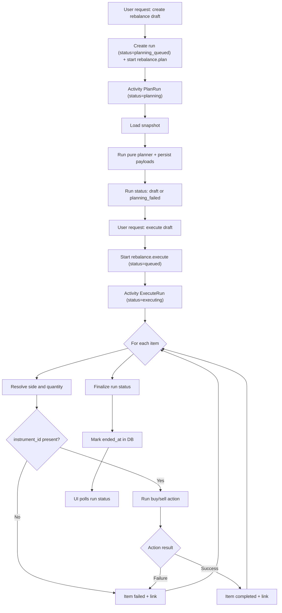
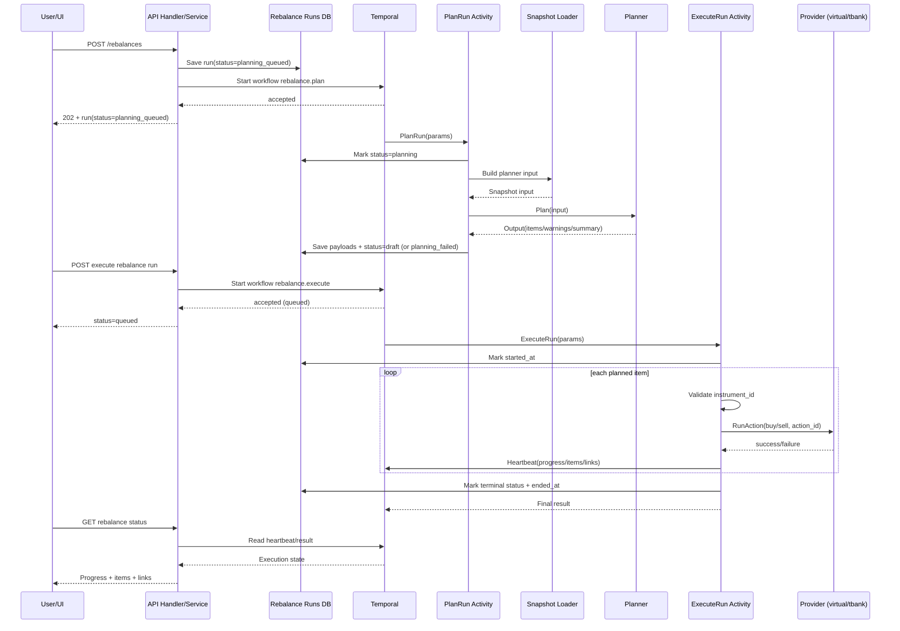

# Rebalancing Execution Pipeline

This document describes the end-to-end rebalance flow in general phases, from user request to provider-side execution.

## Scope

- Covers planning draft creation and execution orchestration.
- Covers execution for automatic providers (`virtual`, `tbank`).
- Uses API-level and workflow-level terminology (not provider-internal implementation details).

## Phases

1. Draft request
- User calls `POST /api/me/portfolios/:id/rebalances`.
- System validates profile/config, creates run with status `planning_queued`, starts Temporal planning workflow (`rebalance.plan`), and returns `202 Accepted`.

2. Temporal planning workflow run
- Workflow `rebalance.plan` runs activity `rebalance.plan_run_activity`.
- Activity transitions run status to `planning`.

3. Snapshot assembly
- Worker loads portfolio holdings, cash balances, replication config, benchmark composition, and instrument prices.
- Worker resolves/fills instrument IDs at snapshot build time (provider-aware).
- Worker builds normalized planner input.

4. Pure planning and draft persistence
- Worker executes planning algorithm (`full`) on normalized input.
- Worker persists run payloads (input/output/summary/warnings) and transitions:
  - to `draft` on success
  - to `planning_failed` on planning failure

5. Execution start request
- User calls `POST /api/me/portfolios/:id/rebalances/:rebalanceId/execute`.
- System validates run state (`draft` or `failed`) and queues Temporal workflow.
- API returns run status `queued`.

6. Temporal execution workflow run
- Workflow `rebalance.execute` runs activity `rebalance.execute_run_activity`.
- Activity marks run execution start and initializes in-memory execution state from planned items.

7. Item execution loop
- For each actionable item:
  - Resolve side and quantity.
  - Validate `instrument_id` is present.
  - Execute provider action (`buy` / `sell`) via portfolio provider abstraction.
  - Record success/failure link and heartbeat progress.

8. Finalization
- Compute final run status:
  - `completed`
  - `partially_completed`
  - `failed`
- Mark run execution finished in DB with terminal status and `ended_at`.

9. Pollable run status
- UI polls `GET /api/me/portfolios/:id/rebalances/:rebalanceId/status`.
- While workflow is running, status is served from Temporal heartbeat.
- After workflow completion, status is served from workflow result.
- Status payload includes coarse run `status` plus stage telemetry (`stage_code`, `stage_message`,
  `stage_index`, `stage_total`) so UI can display what the planner/executor is currently doing.

## Run Status Lifecycle

```text
planning_queued -> planning -> (draft | planning_failed)
draft|failed -> queued -> executing -> (completed | partially_completed | failed)
```

## Item Status Lifecycle

```text
planned -> executing -> (completed | failed)
unresolved (non-actionable from planning)
planned with missing instrument_id -> failed
```

## High-Level Flow Diagram



## Sequence Diagram



## Provider Notes

- Automatic execution is currently supported for `virtual` and `tbank`.
- Provider execution is called through the unified portfolio provider action interface.
- Execution uses deterministic `action_id` generation for retry/idempotency behavior.
- Execution does not perform runtime instrument resolution; missing `instrument_id` is treated as an item execution error.
