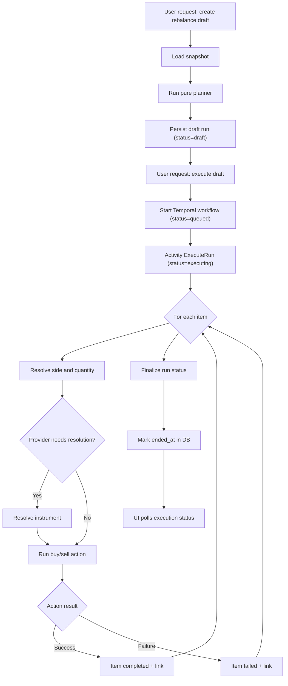
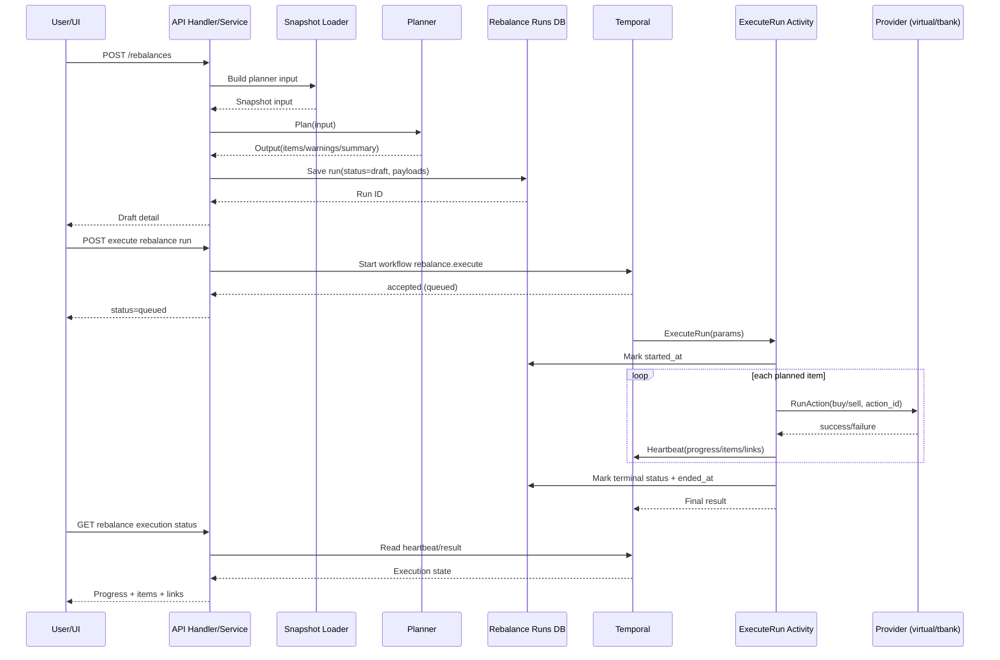

# Rebalancing Execution Pipeline

This document describes the end-to-end rebalance flow in general phases, from user request to provider-side execution.

## Scope

- Covers planning draft creation and execution orchestration.
- Covers execution for automatic providers (`virtual`, `tbank`).
- Uses API-level and workflow-level terminology (not provider-internal implementation details).

## Phases

1. Draft request
- User calls `POST /api/me/portfolios/:id/rebalances`.
- System validates profile/config and starts draft creation.

2. Snapshot assembly
- Load portfolio holdings, cash balances, replication config, benchmark composition, and instrument prices.
- Build normalized planner input.

3. Pure planning
- Execute planning algorithm (`full`) on normalized input.
- Produce planned items (`planned` / `unresolved`), warnings, and summary.

4. Draft persistence
- Persist run snapshot payloads (input/output/summary) with run status `draft`.
- Return draft detail to UI.

5. Execution start request
- User calls `POST /api/me/portfolios/:id/rebalances/:rebalanceId/execute`.
- System validates run state and queues Temporal workflow.
- API returns run status `queued`.

6. Temporal workflow run
- Workflow `rebalance.execute` runs activity `rebalance.execute_run_activity`.
- Activity marks run execution start and initializes in-memory execution state from planned items.

7. Item execution loop
- For each actionable item:
  - Resolve side and quantity.
  - Optionally resolve provider instrument (`tbank` path).
  - Execute provider action (`buy` / `sell`) via portfolio provider abstraction.
  - Record success/failure link and heartbeat progress.

8. Finalization
- Compute final run status:
  - `completed`
  - `partially_completed`
  - `failed`
- Mark run execution finished in DB with terminal status and `ended_at`.

9. Pollable execution status
- UI polls `GET /api/me/portfolios/:id/rebalances/:rebalanceId/execution`.
- While workflow is running, status is served from Temporal heartbeat.
- After workflow completion, status is served from workflow result.

## Run Status Lifecycle

```text
draft -> queued -> executing -> (completed | partially_completed | failed)
```

## Item Status Lifecycle

```text
planned -> executing -> (completed | failed)
unresolved (non-actionable from planning)
```

## High-Level Flow Diagram



## Sequence Diagram



## Provider Notes

- Automatic execution is currently supported for `virtual` and `tbank`.
- Provider execution is called through the unified portfolio provider action interface.
- Execution uses deterministic `action_id` generation for retry/idempotency behavior.
